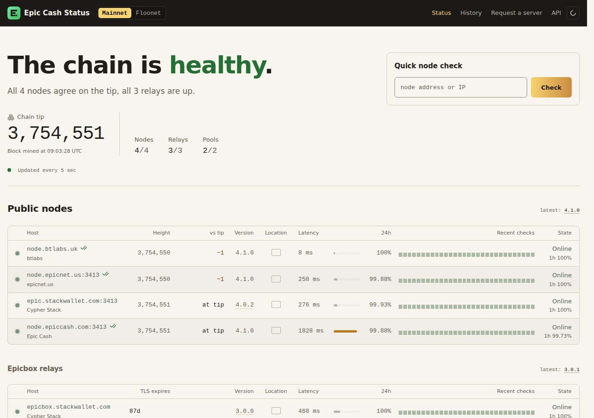

# epic-status

A status page for the Epic Cash network. It checks public nodes, Epicbox relays and
mining pools on mainnet and floonet, and shows which are up, in sync and on the same
chain. Live at <https://status.btlabs.uk>.



## Run your own instance

### Requirements

- Linux with Python 3.12 and [uv](https://docs.astral.sh/uv/)
- Outbound HTTPS/WSS to the hosts you monitor
- For a public site: nginx and a TLS certificate

### Setup

```sh
git clone https://github.com/blacktyger/epic-status.git && cd epic-status
uv sync
cp .env.example .env
```

In `.env`, set at least `EPIC_STATUS_SITE_URL` (your public URL) and
`EPIC_STATUS_PROBER_ID` (a name for where it runs, e.g. `yourname-nyc`). Every other line
is optional and commented. Keep `.env` out of git.

`config/targets.toml` lists what to monitor. It ships with the known public hosts.

### Connect your own Epic node (optional)

Only the node's foreign API (`/v2/foreign`) is used. Never give it your owner API or
`api_secret`. Add the node to `config/targets.toml` by its public URL, even if it runs
on the same machine:

```toml
[[node]]
slug = "node.example.org"
display_host = "node.example.org"
endpoint = "https://node.example.org"
operator = "Your name"
ours = true
```

### Run

```sh
uv run epic-status serve
```

Open <http://127.0.0.1:13431>. To probe one host without starting the service:
`uv run epic-status check node.epiccash.com:3413`.

### Deploy

Run it under systemd behind nginx, bound to loopback. Use `ops/systemd/epic-status.service`
and `ops/nginx/`; each file's header has its install commands. Edit the paths, user and
`server_name` for your machine first. Back up `data/status.db`.

## Licence

MIT. See `LICENSE`.
